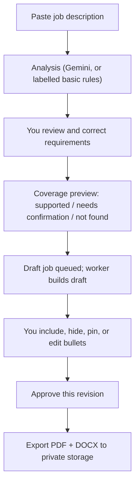
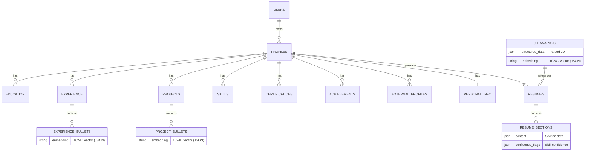

<p align="center">
  <h1 align="center">📄 OneResume</h1>
  <p align="center">
    <strong>AI-Powered Role-Specific Resume Generation Platform</strong>
  </p>
  <p align="center">
    Maintain one profile. Generate infinite, tailored, ATS-optimized resumes — powered by Generative AI.
  </p>
</p>

<p align="center">
  
  
  
  
  
  
  
</p>

---

## 🧠 Problem Statement

Job applicants must tailor their resumes for *every* role to maximize relevance and **ATS (Applicant Tracking System)** compatibility. This process is time-consuming, repetitive, and error-prone — especially when applicants already have a rich professional background.

**OneResume** solves this by maintaining a **single, structured user profile** and automatically generating **role-specific, ATS-optimized resumes** from any Job Description (JD) — no manual rebuilding required.

---

## ✨ Key Features

| Feature | Description |
|---|---|
| 🧑‍💼 **Centralized Profile** | Store all your professional data once — or import it from a PDF/DOCX resume and correct it before saving |
| 📋 **Reviewed JD Analysis** | Gemini (or labelled basic rules) extracts requirements; you correct them before anything is generated |
| 🔗 **Semantic Matching** | 1024-dimensional multilingual embeddings power cosine-similarity scoring to match your profile against each JD |
| 🏆 **Composite Relevance Scoring** | Multi-factor scoring engine weighing semantic similarity, skill importance, section priority, recency, and ATS keyword overlap |
| ✍️ **Your Wording, Your Approval** | Drafts use your own bullets. Checked suggestions are offered beside them with changes highlighted; you accept, edit, hide, or pin, then approve a specific revision before export |
| 📊 **ATS-Friendly Output** | Single-column template with standard headings and selectable text |
| 📥 **Multi-Format Export** | Download your resume as **PDF** (HTML template rendered with WeasyPrint) or **DOCX** — professionally formatted and ready to submit |
| 🔄 **Resume Versioning** | Each export is a version you can compare, restore as a new draft, and mark as sent; files are read back and checked before they are offered |
| 🛡️ **Evidence Labels** | Every requirement is *supported*, *needs confirmation* (skills list only), or *not found* — gaps are shown, never filled in |

---

## 🏗️ Architecture Overview

```
┌─────────────────────────────────────────────────────────────────────────┐
│                        FRONTEND (Next.js 16 + React 19)                │
│   ┌──────────┐  ┌────────────┐  ┌──────────────┐  ┌────────────────┐  │
│   │ Homepage │  │  Dashboard │  │  Profile Mgmt│  │  Resume View   │  │
│   └────┬─────┘  └─────┬──────┘  └──────┬───────┘  └───────┬────────┘  │
│        └──────────────┼────────────────┼───────────────────┘           │
│                       │           REST API                            │
└───────────────────────┼───────────────────────────────────────────────┘
                        │
┌───────────────────────┼───────────────────────────────────────────────┐
│                  BACKEND (FastAPI + Python 3.10+)                     │
│                       │                                               │
│   ┌───────────────────▼────────────────────────────────────────────┐  │
│   │                    ORCHESTRATOR SERVICE                        │  │
│   │  Coordinates the end-to-end resume generation pipeline         │  │
│   └───┬────────┬─────────┬──────────┬──────────┬──────────┬───────┘  │
│       │        │         │          │          │          │           │
│   ┌───▼──┐ ┌──▼───┐ ┌───▼───┐ ┌───▼───┐ ┌───▼───┐ ┌───▼────┐     │
│   │  JD  │ │Embed │ │Score  │ │Relev. │ │ LLM   │ │  ATS   │     │
│   │Anlyzr│ │ Svc  │ │Engine │ │Select.│ │ Svc   │ │Optimzr │     │
│   └──────┘ └──────┘ └───────┘ └───────┘ └───────┘ └────────┘     │
│       │        │         │          │          │          │           │
│   ┌───▼────────▼─────────▼──────────▼──────────▼──────────▼───────┐  │
│   │  Resume Assembler → PDF Renderer → Export Service (PDF/DOCX)  │  │
│   └──────────────────────────────────────────────────────────────┘   │
│                                                                       │
│   ┌──────────────────────────────────┐                                │
│   │  PostgreSQL (SQLAlchemy+Alembic) │                                │
│   │  Users │ Profiles │ JD Analysis  │                                │
│   │  Resumes │ Resume Sections       │                                │
│   └──────────────────────────────────┘                                │
└───────────────────────────────────────────────────────────────────────┘
                        │                          │
              ┌─────────▼────────┐       ┌─────────▼────────┐
              │  Google Gemini   │       │  Pinecone Embed  │
              │  (gemini-3-flash │       │  (multilingual-  │
              │   -preview)      │       │   e5-large)      │
              └──────────────────┘       └──────────────────┘
```

---

## 🔬 GenAI Technology Deep Dive

OneResume leverages two distinct generative AI services, each with a clearly defined responsibility boundary — ensuring **no AI overreach** and **full explainability**.

### 1. Google Gemini (`gemini-3-flash-preview`)

Every call goes through `llm_client.py` (Google's `google-genai` SDK): JSON output against a Pydantic schema, a low thinking level to keep cost down, and token usage logged per purpose.

| Use Case | Service | Responsibility |
|---|---|---|
| **Resume Import** | `import_service.py` | Maps uploaded resume text into profile sections, copying wording exactly |
| **JD Analysis** | `jd_analyzer.py` | Extracts the role title, required and preferred skills, keywords, level, and category |
| **Suggested Rewording** | `rewrite_service.py` | Proposes clearer wording for included draft bullets |
| **Rewording Check** | `rewrite_service.py` | A second call compares each original and rewrite and flags meaning drift |

**Key Design Principles:**
- The LLM proposes; the user decides. Suggestions never replace your wording until you accept them
- Every suggestion passes deterministic checks first (`claim_checks.py`): it is blocked if it adds a number, a tool or skill, a stronger verb ("helped" → "led"), a seniority word, or a lot of length that the original does not have. Only suggestions that also pass the second Gemini check are offered
- Text from resumes and job descriptions is treated as untrusted data in every prompt
- Without a key, or when a call fails, each feature falls back to labelled basic mode. Background jobs wait out rate limits (HTTP 429); interactive requests fall back at once

### 2. Pinecone Inference API (`multilingual-e5-large`)

| Aspect | Detail |
|---|---|
| **Model** | `multilingual-e5-large` — a state-of-the-art multilingual embedding model |
| **Dimensions** | 1024-dimensional dense vectors |
| **Hosted On** | Pinecone Inference API (cloud-hosted, no local GPU required) |
| **Input Type** | `passage` type with `END` truncation |
| **Batch Support** | Yes — bulk embedding generation for efficiency |

**Embedding Strategy:**
- **Bullet-level embeddings** — each experience/project bullet is individually embedded for fine-grained matching
- **Section-level embeddings** — average of constituent bullet embeddings for fast section ranking
- **JD embeddings** — composite text (`role_title + must_have_skills + keywords`) embedded for comparison
- Embeddings are **stored alongside relational data** and reused unless content changes — minimizing redundant API calls

### 3. Composite Scoring Engine

The scoring engine combines multiple signals into a single relevance score:

```
final_score = semantic_similarity
              × skill_importance_weight    (1.5× for must-have, 1.0× for nice-to-have)
              × section_priority_weight    (1.0× experience → 0.5× certification)
              × recency_weight             (1.0 for current, decays 0.05/year, min 0.6)
              + keyword_bonus              (0.05 per keyword match, capped at 0.3)
```

### 4. Must-Have Skill Handling (Graceful Degradation)

When a required skill is missing from the profile, OneResume uses a 3-tier confidence system:

| Tier | Strategy | Confidence |
|---|---|---|
| 1 | **Direct match** — exact or substring match in profile skills | `strong` |
| 2 | **Semantic inference** — skill mentioned in bullet text, or cosine similarity > 0.6 | `inferred` |
| 3 | **Fallback** — closest relevant content included without fabrication | `weak` |

> **Resume generation never fails** due to missing skills.

---

## 🛠️ Technology Stack

### Backend

| Technology | Version | Purpose |
|---|---|---|
| **Python** | 3.12 recommended (≥ 3.10) | Core language |
| **FastAPI** | ≥ 0.104 | Async REST API framework |
| **SQLAlchemy** | ≥ 2.0 | ORM with declarative models |
| **Pydantic** | ≥ 2.5 | Request/response validation & settings management |
| **Alembic** | ≥ 1.13 | Database migration toolkit |
| **PostgreSQL** | 17 | Database (Docker Compose locally); tests use in-memory SQLite |
| **google-genai** | 2.31 | Google Gemini SDK |
| **pinecone** | ≥ 5.0.0 | Pinecone Inference API for embeddings |
| **NumPy** | ≥ 1.24 | Vector math and cosine similarity |
| **python-docx** | ≥ 1.1 | DOCX resume export |
| **Jinja2** | ≥ 3.1 | HTML resume template rendering |
| **WeasyPrint** | ≥ 63 | HTML → PDF rendering |
| **pwdlib (Argon2)** | ≥ 0.2 | Password hashing; sessions are httpOnly cookies |
| **Uvicorn** | ≥ 0.24 | ASGI server |

### Frontend

| Technology | Version | Purpose |
|---|---|---|
| **Next.js** | 16.1.6 | React meta-framework with App Router |
| **React** | 19.2.3 | UI library |
| **TypeScript** | ≥ 5 | Type-safe frontend development |
| **Lucide React** | ≥ 0.575 | Icon library |
| **CSS Modules** | — | Scoped, componentized styling |

### Testing

| Technology | Purpose |
|---|---|
| **pytest** | Test runner |
| **pytest-asyncio** | Async test support |
| **httpx** | Async HTTP client for API testing |
| **pytest-cov** | Code coverage |

---

## 📁 Project Structure

```
OneResume/
├── backend/
│   ├── app/
│   │   ├── main.py                    # FastAPI app entry point & router registration
│   │   ├── config.py                  # Pydantic settings (env vars, model configs)
│   │   ├── database.py                # SQLAlchemy engine, session factory, Base
│   │   ├── domain/
│   │   │   └── resume_draft.py        # Core domain objects (ResumeDraft, ScoredBullet, JDData)
│   │   ├── models/
│   │   │   ├── user.py                # User model (auth, ownership)
│   │   │   ├── profile.py             # Profile + all section models (experience, education, etc.)
│   │   │   ├── jd.py                  # JD analysis model
│   │   │   └── resume.py              # Resume + resume sections models
│   │   ├── repositories/              # Data access layer
│   │   ├── routers/
│   │   │   ├── auth.py                # /api/auth — register, sign in/out, password reset, account deletion
│   │   │   ├── profiles.py            # /api/profile — the signed-in user's profile and sections
│   │   │   ├── jd.py                  # /api/jd — analysis, review, coverage
│   │   │   ├── drafts.py              # /api/drafts — request, edit, approve, export
│   │   │   ├── jobs.py                # /api/jobs — background job status and retry
│   │   │   └── resumes.py             # /api/resumes — exported resumes and downloads
│   │   ├── schemas/                   # Pydantic request/response schemas
│   │   ├── services/
│   │   │   ├── draft_service.py       # Build, edit, approve, and export drafts
│   │   │   ├── job_service.py         # Database-backed background jobs
│   │   │   ├── evidence_service.py    # Requirement evidence labels (token-aware)
│   │   │   ├── import_service.py      # PDF/DOCX resume import (Gemini + fallback)
│   │   │   ├── jd_analyzer.py         # JD → structured data (Gemini + fallback)
│   │   │   ├── embedding_service.py   # Text → 1024D vectors (Pinecone)
│   │   │   ├── scoring_engine.py      # Composite relevance scoring
│   │   │   ├── relevance_selector.py  # Draft content: what starts included, in profile order
│   │   │   ├── llm_client.py          # The single Gemini client (schemas, retries, usage)
│   │   │   ├── rewrite_service.py     # Suggested rewording plus a second-model check
│   │   │   ├── claim_checks.py        # Deterministic checks that a rewrite adds nothing
│   │   │   ├── resume_assembler.py    # Final resume data assembly
│   │   │   ├── pdf_renderer.py        # HTML template → PDF (WeasyPrint)
│   │   │   └── export_service.py      # DOCX export (python-docx)
│   │   └── templates/                 # Jinja2 HTML resume template
│   ├── tests/                         # Test suite (runs offline)
│   ├── migrations/                    # Alembic schema migrations
│   ├── storage/                       # Private generated files (gitignored)
│   └── pyproject.toml                 # Python project config & dependencies
│
├── frontend/
│   ├── src/
│   │   ├── app/
│   │   │   ├── page.tsx               # Landing page (auth flow)
│   │   │   ├── layout.tsx             # Root layout
│   │   │   ├── globals.css            # Global design system
│   │   │   └── dashboard/
│   │   │       ├── page.tsx           # Dashboard — resume overview
│   │   │       ├── layout.tsx         # Dashboard layout with sidebar
│   │   │       ├── profile/           # Profile management page
│   │   │       ├── import/            # Resume upload and review
│   │   │       ├── analyze/           # Job description review and coverage
│   │   │       ├── drafts/            # Draft list and review page
│   │   │       └── resumes/           # Resume history & download
│   │   ├── components/
│   │   │   ├── Navbar.tsx             # Navigation bar
│   │   │   ├── GeometricCard.tsx      # Reusable card component
│   │   │   └── StatusCountdown.tsx    # Status indicator component
│   │   └── lib/                       # Shared utilities
│   ├── package.json
│   └── tsconfig.json
│
├── PRD.md                             # Product Requirements Document
├── databaseschema.md                  # Database schema design
└── feature to component Mapping.md    # Feature → component mapping
```

---

## 🔄 From Job Description to Resume

Resumes are proposals you review and approve before anything is exported:



| Step | Service | What Happens |
|---|---|---|
| Analysis | `jd_analyzer.py`, `jd_service.py` | Gemini extracts requirements; without a key (or on failure) a rule-based analysis runs and is labelled basic. Text aimed at AI tools ("ignore previous instructions") is removed and flagged |
| Review | `PUT /api/jd/{id}` | The user's corrected requirements replace the analysis |
| Coverage | `evidence_service.py` | Token-aware matching labels each requirement: *supported* (an experience, project, education, certification, or achievement mentions it), *needs confirmation* (only the skills list does), or *not found*. Java never matches JavaScript; C never matches C# |
| Draft job | `job_service.py`, `app/worker.py` | A database-backed job with an idempotency key; the worker builds the draft and failed jobs can be retried |
| Selection | `relevance_selector.py`, `scoring_engine.py` | Every entry is kept so it can be restored; scores decide what starts included. Entries keep profile order; wording is the user's own. Embeddings are used when Pinecone is configured, otherwise labelled exact-word matching |
| Suggestions | `rewrite_service.py`, `claim_checks.py` | Each included bullet may get a suggestion; rule checks and a second Gemini call decide whether it is offered (safe) or blocked, with reasons |
| Review and approval | `draft_service.py` | Accepting a suggestion or editing creates a new revision and clears approval; accepted and edited bullets are listed at approval |
| Length check | `GET /api/drafts/{id}/layout` | Renders the current revision to count pages; when it overflows, suggests bullets to hide, starting with ones that support no requirement |
| Export | `resume_assembler.py`, `pdf_renderer.py`, `export_service.py`, `output_check.py` | Only the approved revision is exported, once per revision, as a new resume version. Each file is read back and must contain every heading, entry, and bullet in order; a format that fails is not offered. Page overflow is recorded as a warning |
| History | `version_service.py` | Each version keeps the exact content it was exported from: compare two versions, restore one as a new draft, or record when it was sent. Downloads are checked against the stored checksum |

Without API keys every step still works in a clearly labelled basic mode.

---

## 🚀 Getting Started

### Prerequisites

- **Python** 3.12 (tested; [uv](https://docs.astral.sh/uv/) installs it in one command)
- **Node.js** ≥ 18
- **Docker** (for PostgreSQL)
- **pango** for PDF export (`brew install pango` on macOS, `apt install libpango-1.0-0 libpangoft2-1.0-0` on Debian/Ubuntu)

### 1. Clone the Repository

```bash
git clone https://github.com/NayanshiSingh/OneResume.git
cd OneResume
```

### 2. Backend Setup

```bash
cd backend

# Start PostgreSQL (host port 5433)
docker compose up -d --wait db

# Create a Python 3.12 virtual environment and install dependencies
uv venv --python 3.12 .venv
uv pip install --python .venv/bin/python -e ".[dev]"
source .venv/bin/activate  # Windows: .venv\Scripts\activate

# Configure environment variables (database URL, API keys)
cp .env.example .env

# Create or upgrade the database schema
alembic upgrade head

# Start the backend server
# macOS: WeasyPrint needs Homebrew's libraries on the loader path
DYLD_FALLBACK_LIBRARY_PATH=/opt/homebrew/lib uvicorn app.main:app --reload --port 8000

# In a second terminal: the worker that builds drafts
DYLD_FALLBACK_LIBRARY_PATH=/opt/homebrew/lib python -m app.worker
```

### 3. Frontend Setup

```bash
cd frontend

# Install dependencies
npm install

# Start the development server
npm run dev
```

Open `http://localhost:3000`. Next.js proxies `/api/*` to the backend (`BACKEND_URL`, default `http://localhost:8000`), so the session cookie stays first-party.

Without `GEMINI_API_KEY`, resume import and JD analysis use rule-based parsing. Without `PINECONE_API_KEY`, drafts use exact-word matching. Both are labelled "basic mode" in the app; nothing is downgraded silently. Drafts always keep your own wording.

Password reset emails are written to the backend log in development.

### 4. API Documentation

With the backend running, visit:
- **Swagger UI**: [http://localhost:8000/docs](http://localhost:8000/docs)
- **ReDoc**: [http://localhost:8000/redoc](http://localhost:8000/redoc)

---

## 🧪 Running Tests

```bash
cd backend

# Run full test suite (offline: Gemini and Pinecone are faked)
# macOS: prefix with DYLD_FALLBACK_LIBRARY_PATH=/opt/homebrew/lib so the PDF test runs
pytest

# Run with coverage
pytest --cov=app --cov-report=term-missing

# Run specific test modules
pytest tests/test_scoring_engine.py
pytest tests/test_jd_analyzer.py
pytest tests/test_integration.py
```

**Evaluation set (live):** `python -m evaluation.run_eval` loads the 8 synthetic personas into a throwaway in-memory database, checks JD extraction on the 20 job descriptions, builds the 35 task drafts with real embeddings and suggestions, and scores them against the answer key (evidence labels, must-include and should-omit entries, and safe suggestions that introduce forbidden claims). It stops at `--max-cost` (default $1.50) and writes a JSON report plus a calibration sheet to `backend/evaluation/results/` (gitignored). Use `--rpm 4` on the Gemini free tier (5 requests per minute) and `--offline` to check the harness without any API calls. Do not use the free tier with real resumes: Google may use free-tier data to improve its products.

**Test Suite Coverage:**

| Module | Tests |
|---|---|
| `test_auth.py` | Registration, sessions, password reset, origin check, account deletion |
| `test_ownership.py` | Users cannot read, change, or download each other's data |
| `test_profile_api.py` | Profile editing, ordering, and stale-embedding invalidation |
| `test_exports.py` | Private artifact storage, correct download formats, template escaping |
| `test_migrations.py` | Alembic migrations match the models |
| `test_evidence_service.py` | Token-aware evidence labels |
| `test_import.py` | Resume import parsing, preview, and apply |
| `test_jobs.py` | Background jobs: idempotency, failure, retry, stale reclaim |
| `test_drafts.py` | Draft selection, edits, approval by revision, export |
| `test_jd_analyzer.py` | JD analysis (Gemini + fallback) |
| `test_embedding_service.py` | Embedding generation & cosine similarity |
| `test_scoring_engine.py` | Composite scoring formula |
| `test_rewrites.py` | Claim checks, the two-step suggestion check, accepting suggestions, rate-limit retries |
| `test_eval_scoring.py` | Evaluation scoring functions |
| `test_limits.py` | Daily limits, sign-in throttling, reset-email cap |
| `test_versions.py` | Read-back checks, page counts, damaged files, compare, restore, sent dates, length check |
| `test_resume_assembler.py` | Resume data assembly |
| `test_edge_cases.py` | Edge cases & error handling |

---

## 🌐 API Endpoints

| Method | Endpoint | Description |
|---|---|---|
| `POST` | `/api/auth/register` | Create an account and sign in |
| `POST` | `/api/auth/login` / `/api/auth/logout` | Sign in / out (httpOnly session cookie) |
| `GET` | `/api/auth/me` | Current user |
| `POST` | `/api/auth/password-reset/request` / `confirm` | Password reset by single-use emailed link |
| `DELETE` | `/api/auth/account` | Delete the account, profile, and generated files |
| `GET` | `/api/profile` | The signed-in user's profile with all sections |
| `PUT` | `/api/profile/personal-info` | Save name and contact details |
| `POST` / `PATCH` / `DELETE` | `/api/profile/{section}[/{id}]` | Add, edit, or remove education, skills, experience, projects, certifications, achievements, external-profiles |
| `PUT` | `/api/profile/{section}/order` | Reorder a section |
| `POST` / `PATCH` / `DELETE` / `PUT` | `/api/profile/{experience\|projects}/…/bullets` | Add, edit, remove, and reorder bullets |
| `POST` | `/api/jd/analyze` | Submit and analyze a job description |
| `POST` | `/api/profile/import` → `/api/profile/import/apply` | Preview an uploaded PDF/DOCX, then save the reviewed result |
| `PUT` | `/api/jd/{id}` | Save reviewed requirements |
| `GET` | `/api/jd/{id}/coverage` | Evidence label for each requirement |
| `POST` | `/api/drafts` | Queue a draft (returns a job; poll `GET /api/jobs/{id}`) |
| `GET` / `PATCH` / `DELETE` | `/api/drafts/{id}` | Read, edit (include, pin, edit or revert bullets), or delete a draft |
| `POST` | `/api/drafts/{id}/approve` / `export` | Approve the current revision, then export it |
| `GET` | `/api/drafts/{id}/layout` | Page count and suggested cuts |
| `PATCH` | `/api/resumes/{id}` | Record or clear the date a version was sent |
| `GET` | `/api/resumes/{id}/compare/{other}` | Changes between two versions |
| `POST` | `/api/resumes/{id}/restore` | Start a new draft from a version |
| `GET` | `/api/system/ai-status` | Which AI providers are configured |
| `GET` | `/api/resumes` / `/api/resumes/{id}` | List / fetch resumes with available formats |
| `GET` | `/api/resumes/{id}/download?format=pdf\|docx` | Download a generated file |
| `DELETE` | `/api/resumes/{id}` | Delete a resume and its files |

Every route except health and account creation/sign-in requires a session, and only returns the signed-in user's data. State-changing requests from origins outside `ALLOWED_ORIGINS` are rejected.
| `GET` | `/` | Health check |

---

## ⚙️ Configuration

All configuration is managed via environment variables (loaded from `.env`):

| Variable | Default | Description |
|---|---|---|
| `DATABASE_URL` | `sqlite:///oneresume.db` | Database connection string (`.env.example` points at Docker Postgres) |
| `GEMINI_API_KEY` | — | Google Gemini API key |
| `GEMINI_MODEL` | `gemini-3-flash-preview` | Gemini model identifier |
| `PINECONE_API_KEY` | — | Pinecone API key for embeddings |
| `EMBEDDING_MODEL` | `multilingual-e5-large` | Embedding model name |
| `EMBEDDING_DIM` | `1024` | Embedding vector dimensions |
| `MAX_EXPERIENCE_SECTIONS` | `3` | Max experience sections in resume |
| `MAX_PROJECT_SECTIONS` | `3` | Max project sections in resume |
| `MAX_BULLETS_PER_SECTION` | `5` | Max bullets per entry (one page) |
| `BULLETS_PER_PAGE` | `14` | Experience and project bullets shared across one page |
| `MAX_SKILLS` | `12` | Max skills listed in resume |
| `STORAGE_DIR` | `backend/storage` | Private directory for generated files |
| `SESSION_TTL_DAYS` | `14` | Session lifetime |
| `COOKIE_SECURE` | `false` | Set `true` behind HTTPS |
| `ALLOWED_ORIGINS` | `["http://localhost:3000"]` | Origins allowed to make state-changing requests |
| `APP_BASE_URL` | `http://localhost:3000` | Used to build password reset links |
| `PASSWORD_RESET_TTL_MINUTES` | `30` | Reset link lifetime |
| `DAILY_JD_ANALYSES` / `DAILY_RESUME_IMPORTS` / `DAILY_DRAFTS` | `30` / `10` / `30` | Per-user limits over a rolling 24 hours; over the limit returns 429 with `Retry-After` |
| `LOGIN_FAILURE_LIMIT` / `LOGIN_FAILURE_WINDOW_MINUTES` | `10` / `15` | Failed sign-ins per email before sign-in is paused (applies whether or not the account exists) |
| `RESET_REQUESTS_PER_HOUR` | `3` | Reset emails per address per hour; extra requests get the same response but send nothing |

---

## 📐 Database Schema

The database uses a **relational + hybrid** design with embedding-ready vector storage:



## 📄 License

This project is built as a portfolio project by **Nayanshi Singh**.

